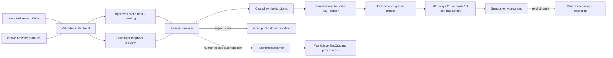

# Architecture

Implemented local path, 2026-10-14. Builder evidence is separate from independent acceptance and tenant verification.

## Working boundary

There is no programmatic connection to SecOps, runtime AI, backend, user account, dataset or remote dependency. Only the human substitutes actual values in workplace tools.

## Implemented files

| Path | Responsibility |
|---|---|
| `site/index.html`, `styles.css`, `favicon.svg` | Semantic shell, early CSP, system fonts, responsive styling and original local mark |
| `site/app.js` | Text-only rendering, privacy acknowledgment, fixed routes, lessons, composer, hints, method/private practice UI |
| `site/query/catalog.js`, `serializer.js` | Immutable finite palette; independently check token IDs before text construction |
| `site/query/parser.js` | Lexer, typed AST, alias and pattern normalization, bounds; no regex execution |
| `site/query/equivalence.js`, `evaluate.js` | Bounded Boolean truth tables and exact normalized pipeline comparison; safe diagnostics |
| `site/state/scoring.js` | Current-attempt grading, stale-state invalidation and one-attempt saved best |
| `site/state/progress.js` | Strict shape/correlation/version validation, opt-in projection, exact-key clear and failure fallback |
| `tools/validate-content.mjs`, `schema.mjs` | Schema keyword subset used by checked-in schemas, semantic references/cycles and query fixtures |
| `tools/files.mjs`, `build.mjs`, `check-artifact.mjs` | Shared explicit file allowlist, content-module generation, fail-closed output inspection and module-graph checks |
| `tools/serve.mjs` | Developer loopback server, exact GET/HEAD routes only, root/subpath support |
| `tests/unit/`, `tests/browser/` | Goal/failure contracts and real built-browser flows |

The generated `dist/content.js` bundles authored JSON. It is never hand-edited or fetched remotely. Runtime uses native ES modules and no dependencies. Development has exact Playwright 1.64.1 and a lockfile. Final verification passed on preferred Node 24.21.0; earlier development used installed Node 25.8.1/npm 11.11.0. The manual-only CI pins checkout/setup-node to revisions verified from their official repositories; it has not run remotely.

## Routes and state

Implemented fixed hash routes: `#course`, `#L01` through `#L06`, `#L01-C01` through `#L06-C02`, `#progress`, `#privacy`. Unknown IDs show a fixed not-found page without reflecting input. This is a reversible simplification of the earlier nested route sketch; no payload enters routing.

Query/method inputs and flags stay in memory and clear on route exit or reload. Token edits clear current grades and acknowledgments. Saved best is a separate non-sensitive record, with all score components from one attempt. Storage is opt-in; future/invalid data is left untouched until explicit action. The app never accesses another storage key. No query/AST/method response/result/timestamp is persisted.

## Artifact and host controls

The build contains exactly thirteen allowlisted files: HTML, CSS, SVG mark, eight runtime JS modules, generated content, and `.nojekyll`. Unexpected existing output or symlinks stop the build without deleting user content. Assets are relative and tested at root and `/KC7-SecOps/`. Developer tools/docs/tests/dependencies are excluded.

Early meta CSP permits only same-origin scripts/styles/images, with connections, forms, workers, frames, objects, fonts and other defaults denied. No inline executable code/style, eval, dynamic code, fetch, clipboard read, service worker or telemetry exists. Reference links are fixed HTTPS, explicit, no-opener/no-referrer. Copy writes only synthetic text.

Meta CSP cannot enforce frame-ancestors. The owner approved GitHub Pages on 2026-10-15; Pages does not expose custom response-header configuration in this deployment. Do not claim framing or Permissions-Policy headers that the host does not supply. The actual HTTPS response MIME types and bytes are checked by `tools/check-live.mjs`; the HTML retains its no-referrer policy and early CSP. Framing is a documented low-severity residual for this course with no privileged action. Host logs, other scripts on the same `mwill20.github.io` origin and release compromise remain residual risks; the repository path is not an origin-isolation boundary. The loopback preview is for developers.

## Pages publication

`.github/workflows/pages.yml` is manually dispatched on `main`. Its read-only build job installs locked development dependencies, runs the full verification suite and uploads only `dist/`. The separate deployment job has only Pages/OIDC write permissions and uses the `github-pages` environment. All directly referenced actions use verified full commit SHAs. No source push automatically publishes a release. The official upload action omits dotfiles, so the twelve web assets are published; `.nojekyll` is a build marker and not needed by Actions publication.

`tools/check-live.mjs` checks the fixed HTTPS address, every published asset's exact bytes and MIME type, and 404 responses for development paths. Actual browser interaction at that address is additional evidence; local browser tests alone do not establish a working deployment. See DEPLOYMENT.md for actual run status rather than inferring deployment from configuration.

## Design choices and limits

One browser entry module keeps this six-lesson app small; reusable parser/state logic remains separate. Normalization lives beside parsing so type and binding checks precede equivalence. No generalized rule engine, plugin system, app login or audit backend is needed for this boundary. Local scores have no authorization value.

Invalid authored content stops the build. Failed browser initialization leaves a fixed CONTENT_INVALID fallback without enabling assessment. Unsupported syntax earns no query points and is distinguished from incorrect intent and parse failure. Tests demonstrate the supported subset, not Google semantics across all possible inputs. See the threat model and evaluation record before release.
